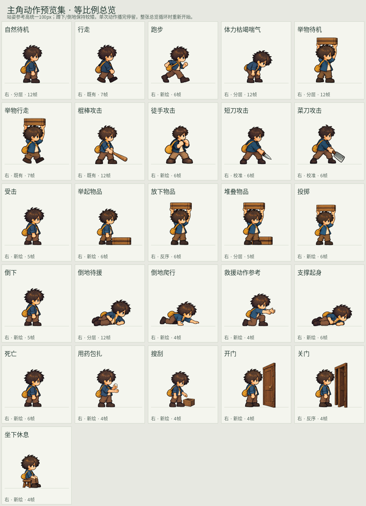

# Sprite Animation Skill

**游戏角色序列帧动画制作**：从角色参考、关键姿势设计到透明 PNG、精灵图集和 GIF 预览，整理自《异县1992》的实际制作与修复过程。

入口是 [SKILL.md](SKILL.md)。这是给 AI 助手使用的工作方法，并附一个处理已有帧的打包脚本。生图由当前环境中可用的图像工具完成，本仓库不自带图像模型、视频服务或 API 凭据；实际可用的生图方法见 [生图方法](references/image-generation.md)。

## 能做什么

- 保持角色比例、服装、朝向和画面尺寸一致。
- 设计待机、走路、跑步、攻击、搬运、救援等动作阶段。
- 处理帧间漂移、循环接缝、透明边缘和手持物握点。
- 区分新绘、复用、镜像、分层、反序和补帧，记录真实来源。
- 输出可检查的帧、图集、预览和元数据；游戏接入另做验证。

重点经验是：先把动作画对，再修定位和边缘。统一包围盒大小会把下蹲姿势放大；只锁整幅图的质心会被武器带偏；混接上身和裤腿容易留下接缝。处理办法和限制见 [验收与常见问题](references/quality-and-pitfalls.md)。

## 使用 Skill

把本仓库放进所用助手支持的 skills 目录。例如支持项目技能发现的客户端可以使用：

```bash
git clone https://github.com/shuishen49/sprite-animation-skill.git \
  .agents/skills/sprite-animation-skill
```

具体技能发现目录以客户端为准。载入后可请求：

> 使用 $sprite-animation-skill，参考这个角色，先做面向右侧的六姿前向直拳。保持游戏里约38px的人物大小，输出透明帧、逐帧表和GIF，暂不接入游戏。

也可以直接让助手阅读本仓库的 `SKILL.md`，按其中的流程工作。

## 只打包已有 PNG

Python 3.10+，第三方依赖仅 Pillow：

```bash
python -m pip install -r requirements.txt
python scripts/pack_frames.py --frames /path/to/rgba-frames \
  --out /path/to/walk-v1 --durations 80 --loop
python -m unittest discover -s tests -v
```

输入为同尺寸、有透明背景的 PNG，按文件名自然顺序排列。输出目录必须为空或不存在；脚本保存透明帧、`sheet.png`、`preview.gif`、`preview.webp`、`contact.png`、`animation.json`、`report.json`。

脚本只做打包、共同裁切及可选的手动锚点平移；不生成动作、不抠背景、不自动把坏姿势修好。完整参数和元数据说明见 [打包说明](references/packing.md)。

## 内容导航

| 文件 | 用途 |
| --- | --- |
| [SKILL.md](SKILL.md) | 助手执行入口与交付约定 |
| [workflow.md](references/workflow.md) | 从参考、关键姿势到接入的实际步骤 |
| [image-generation.md](references/image-generation.md) | 生图方法（灵感平台 Go 直连）与上游工具的等价要求 |
| [prompts.md](references/prompts.md) | 角色一致性、走路、攻击和搬运提示词 |
| [quality-and-pitfalls.md](references/quality-and-pitfalls.md) | 验收项目、典型失败与修复方法 |
| [provenance.md](references/provenance.md) | 方法来源、版本变化与能力边界 |
| [action-spec.json](examples/action-spec.json) | 动作规格示例，供项目自行扩展 |

## 效果图

《异县1992》主角动作预览集·等比例总览：26 个动作，每行 5 个，每格标注方向与制作来源（新绘 / 分层 / 校准 / 镜像 / 反序 / 复用）和帧数。



这张图集中体现了本 Skill 的两条主张：

- **动作语义优先**：奔跑要有腾空、挥击要有接触与收势，不能只是把待机换张脸。
- **来源必须诚实**：26 个条目不等于 26 套全新原画；每个格子的来源标签说明了它到底是怎么来的。

示例角色与历史素材仍在 [原仓库](https://github.com/shuishen49/yixian-1992)，本图仅作方法效果示意，不授予角色素材的使用许可。
